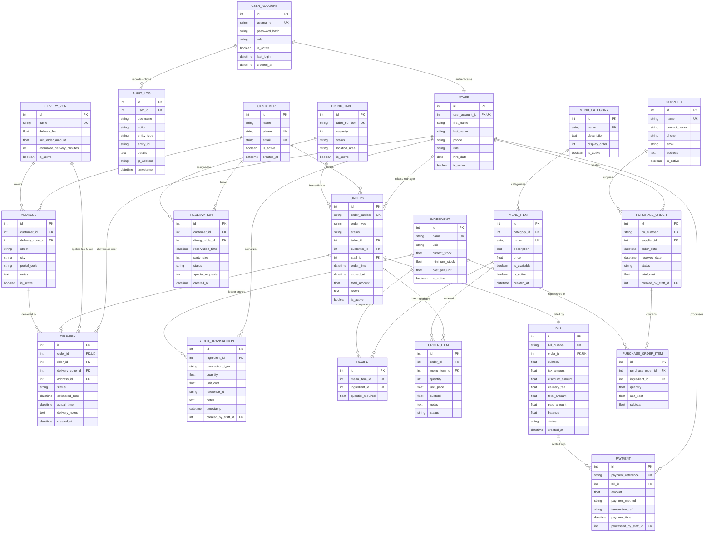

# Restaurant Management System with Delivery
## DBMS Architecture, 3NF/BCNF Normalization & Entity-Relationship Documentation

---

### 1. Mermaid Entity-Relationship (ER) Diagram

---

### 2. DBMS Normalization Analysis (3NF / BCNF)

#### First Normal Form (1NF)
- All attribute domains contain only **atomic (indivisible) values**.
- There are **no repeating groups** or multi-valued arrays inside table rows (e.g., items in an order are factored out into `order_item`; ingredients in a dish are factored into `recipe`).
- Every table has an unambiguous **Primary Key** (`id` surrogate integer).

#### Second Normal Form (2NF)
- The database is in 1NF.
- Every non-prime attribute is **fully functionally dependent** on the primary key.
- In associative tables with candidate composite keys (such as `recipe` with candidate key `(menu_item_id, ingredient_id)` or `purchase_order_item`), non-prime attributes like `quantity_required` or `unit_cost` depend on the whole composite identity, not any single subset.

#### Third Normal Form (3NF)
- The database is in 2NF.
- There are **no transitive dependencies** ($X \to Y \to Z$ where $X$ is the primary key and $Y$ is not a superkey).
- **Separation of Authentication and Employment**:
  - `user_account` stores authentication credentials (`username`, `password_hash`, `role`).
  - `staff` stores employment data (`first_name`, `last_name`, `hire_date`, `phone`).
  - Eliminates transitive dependency and enables separation of concerns.
- **Customer & Address Separation**:
  - `customer` stores patron identity (`name`, `phone`, `email`).
  - `address` stores physical delivery locations and references `delivery_zone_id`.
  - `delivery_zone` holds zone fee and minimum order constraint. A change in zone fee does not affect customer records or require updating hundreds of addresses.
- **Historical Price Integrity in Order Items**:
  - `order_item` stores `unit_price` at the instant the sale was recorded. If the menu price changes in `menu_item`, previous financial receipts and audit balances remain immutable.

#### Boyce-Codd Normal Form (BCNF)
- For every non-trivial functional dependency $X \to Y$, $X$ is a **superkey**.
- Every table is keyed by its unique surrogate primary key, and secondary candidate keys are enforced with database-level `UNIQUE` constraints:
  - `user_account.username`
  - `customer.phone`
  - `dining_table.table_number`
  - `menu_item.name`
  - `delivery_zone.name`
  - `recipe(menu_item_id, ingredient_id)` composite unique
  - `orders.order_number`
  - `bill.order_id` (1-to-1 relationship enforced via unique constraint)
  - `delivery.order_id` (1-to-1 relationship enforced via unique constraint)

---

### 3. Business Rules & DBMS Transaction Enforcements

#### 1. Atomic Order Closing & Recipe Stock Deduction
- **Rule**: When an order transitions to `Completed`:
  - The restaurant table (if Dine-In) is freed (`status = 'Available'`).
  - In the **same database transaction** (`db.session.commit()`):
    - For every `order_item` in the order, all ingredients in `recipe` for that `menu_item` are retrieved.
    - Required deduction: $\text{Deduction} = \text{quantity} \times \text{quantity\_required}$.
    - Stock is deducted from `ingredient.current_stock`.
    - An immutable ledger entry is written to `stock_transaction` (`transaction_type = 'Order_Deduction'`, `quantity = -Deduction`, `reference_id = order_number`).
    - An audit event is recorded in `audit_log`.
  - If any step fails, the entire transaction rolls back (`db.session.rollback()`), preventing stock desynchronization.

#### 2. Payment Cannot Exceed Bill Balance
- **Rule**: A payment transaction cannot be accepted if $\text{payment.amount} > \text{bill.balance}$.
- **Enforcement**:
  - Server calculates $\text{remaining\_balance} = \text{total\_amount} - \text{paid\_amount}$.
  - Rejects attempts with HTTP 400 and validation message: `Payment amount ($X) cannot exceed current bill balance ($Y)`.
  - When payment is accepted: `bill.paid_amount += amount` and `bill.balance -= amount`.
  - If $\text{balance} == 0$, `bill.status = 'Paid'`. Otherwise, `bill.status = 'Partially_Paid'`.

#### 3. No Double-Booking Dining Tables
- **Rule**: A dining table cannot be reserved if another confirmed or seated reservation exists within a 2-hour window.
- **Enforcement**:
  - When booking table $T$ at time $t$:
    $$\text{Conflict exists if } \exists \text{ reservation } R \text{ on table } T \text{ where } |R.\text{time} - t| < 2 \text{ hours} \land R.\text{status} \in \{\text{'Confirmed'}, \text{'Seated'}\}$$
  - The API queries the range $[t - 2\text{h}, t + 2\text{h}]$. If a match is found, an HTTP 409 Conflict is returned, blocking the insertion.

#### 4. Delivery Zone Minimums & Fee Integration
- **Rule**: Delivery orders must have an address belonging to an active delivery zone, and $\text{items subtotal} \ge \text{zone.min\_order\_amount}$.
- **Enforcement**:
  - Delivery fee from the zone is included in the bill calculation:
    $$\text{total\_amount} = \text{subtotal} + \text{tax\_amount} + \text{delivery\_fee} - \text{discount\_amount}$$
  - Delivery dispatch entity created in `Pending` status.

#### 5. Delivery Status Progression
- **Rule**: Permitted state transitions:
  $$\text{Pending} \longrightarrow \text{Assigned (requires rider)} \longrightarrow \text{Out for delivery} \longrightarrow \text{Delivered (or Cancelled)}$$
- **Enforcement**:
  - Validated by the backend transition matrix before committing changes.
  - Delivery completion records `actual_time` and marks order `Completed`.

#### 6. Soft Delete Pattern
- **Rule**: Never perform raw SQL `DELETE` on operational master tables (`customer`, `menu_item`, `dining_table`, `staff`, `supplier`, `ingredient`).
- **Enforcement**: Set `is_active = False`. Queries filter by `is_active == True`, preserving historical financial foreign-key integrity.

#### 7. Audit Trail
- All significant business actions (logins, orders placed, orders closed, payments processed, deliveries assigned, stock adjusted) generate structured immutable rows in `audit_log` with user ID, username, action, entity type, entity ID, description, and IP address.
