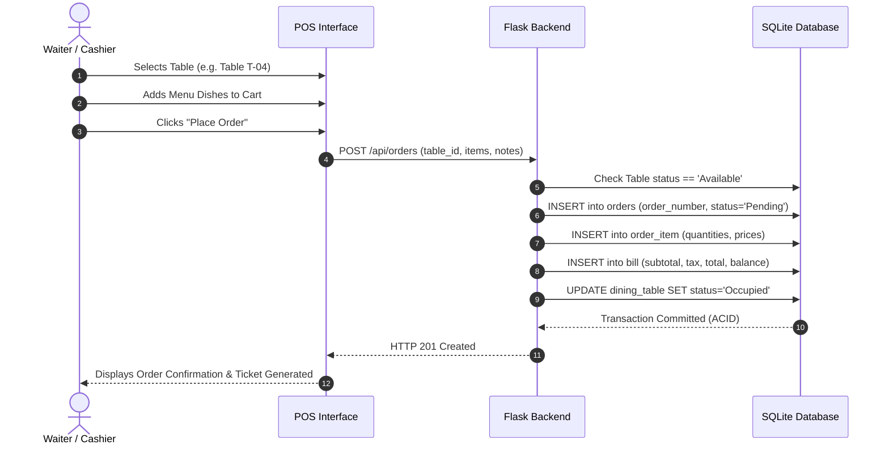
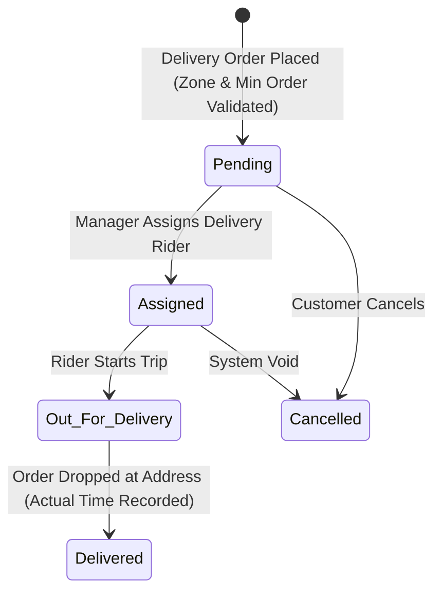

# 🍽️ Gusto POS - Restaurant Management Software
## DBMS Project Defense & Technical Presentation Slide Deck

---

## 📋 Table of Contents / Slide Index

- **Slide 1:** Title & Project Overview
- **Slide 2:** System Architecture (Frontend, Backend, Database)
- **Slide 3:** The Frontend Layer (UI/UX & Interactive Modules)
- **Slide 4:** The Backend Layer (Python / Flask Engine)
- **Slide 5:** What Are REST APIs & How Data Moves
- **Slide 6:** Database Theory: Primary Keys (PK) & Foreign Keys (FK)
- **Slide 7:** DBMS Normalization (3NF & BCNF in Practice)
- **Slide 8:** User Roles & Role-Based Access Control (RBAC)
- **Slide 9:** Workflow 1 — The Dine-In & POS Order Lifecycle
- **Slide 10:** Workflow 2 — Kitchen Display System (KDS) & Order Processing
- **Slide 11:** Workflow 3 — Atomic Inventory Depletion via Recipes (BOM)
- **Slide 12:** Workflow 4 — Delivery Dispatch & Rider Pipeline
- **Slide 13:** Workflow 5 — Billing, Payments & Balance Constraint
- **Slide 14:** Summary, Key Achievements & Q&A

---

<!-- SLIDE 1 -->
# Slide 1: Title & Project Overview

### **Project Title:**
## Gusto POS: Enterprise Restaurant Management & Delivery Desktop Software

### **Presenter / Student:**
- **Course:** Database Management Systems (DBMS)
- **Platform:** Standalone Windows Desktop Software
- **Core Technology Stack:** Python (Flask), SQLite, SQLAlchemy ORM, Modern HTML5/CSS3/JavaScript, pywebview

### **Executive Summary:**
A complete, desktop-first Point-of-Sale (POS) and operations suite built to solve the challenges of restaurant front-of-house (seating, order taking, billing), back-of-house (kitchen tickets, raw inventory recipes), and off-premise logistics (delivery dispatching, distance zones, and driver assignments).

### **Key Highlights:**
- **100% Relational Database Design**: 21 normalized tables meeting strict 3NF/BCNF requirements.
- **Zero Raw SQL Dependencies**: Fully governed by SQLAlchemy ORM with model-level check and unique constraints.
- **Embedded Database**: Local zero-configuration SQLite storage (`restaurant.db`).
- **Granular RBAC**: 6 specialized roles protected by cryptographic password hashing.

---

<!-- SLIDE 2 -->
# Slide 2: High-Level System Architecture

```
+---------------------------------------------------------------------------------------+
|                                    USER INTERFACE                                     |
|  Desktop Native Window (pywebview / Standalone Chromium Engine - Zero Browser Chrome) |
+---------------------------------------------------------------------------------------+
                                           │
                                           │ DOM Events & User Interactions
                                           ▼
+---------------------------------------------------------------------------------------+
|                                    FRONTEND LAYER                                     |
|  • HTML5 Semantic Templates (login.html, index.html)                                  |
|  • CSS3 Modern UI Component Library (style.css - POS, KDS Tickets, Floor Cards)       |
|  • JavaScript Client State & Router (app.js - Cart Calculations, Async Fetch)         |
+---------------------------------------------------------------------------------------+
                                           │
                                           │ Asynchronous JSON HTTP Calls
                                           ▼
+---------------------------------------------------------------------------------------+
|                                    BACKEND LAYER                                      |
|  • Flask REST API Router (app.py)                                                     |
|  • Security & Session Manager (Role-Based Decorator @role_required, Werkzeug Hashing) |
|  • Business Logic Engine (Atomic Transactions, Conflict Avoidance, Pipeline Gates)    |
+---------------------------------------------------------------------------------------+
                                           │
                                           │ SQLAlchemy ORM Python Objects
                                           ▼
+---------------------------------------------------------------------------------------+
|                                    DATABASE LAYER                                     |
|  • Embedded SQLite Engine (restaurant.db)                                             |
|  • 21 Relational Entity Models in 3NF / BCNF (models.py)                              |
|  • Immutable Transaction Ledgers (stock_transaction, audit_log)                       |
+---------------------------------------------------------------------------------------+
```

---

<!-- SLIDE 3 -->
# Slide 3: The Frontend Layer (UI & Client-Side Logic)

### **What is the Frontend?**
The frontend is the visual and interactive interface that users (cashiers, chefs, waiters, managers) see, touch, and operate.

### **Core Frontend Components:**
1. **HTML5 Semantic Templates**:
   - `templates/login.html`: Secure gateway with role autofill test buttons.
   - `templates/index.html`: Responsive single-page application (SPA) containing 14 operational modules and interactive modal dialogs.
2. **CSS3 Custom POS Styling (`static/css/style.css`)**:
   - Dark sidebar navigation with visual role badges.
   - High-contrast Kitchen Display cards (KDS) with urgency indicators.
   - Color-coded restaurant floor plan (Green = Available, Red = Occupied, Amber = Reserved).
   - Thermal-style printable paper receipts.
3. **Client-Side Application Controller (`static/js/app.js`)**:
   - **Dynamic POS Shopping Cart**: Live quantity increments, tax (8%) calculations, and delivery zone fee inclusions.
   - **Asynchronous AJAX Communications**: Updates UI instantly without reloading the page.
   - **Role-Based Element Pruning**: Automatically hides administrative tabs when lower-privilege roles (e.g. Waiter or Rider) log in.

---

<!-- SLIDE 4 -->
# Slide 4: The Backend Layer (Python / Flask Engine)

### **What is the Backend?**
The backend is the server-side brain of the software. It processes data, authenticates identities, validates operational rules, and executes ACID-compliant database operations.

### **Key Backend Capabilities:**
1. **REST API Controllers (`app.py`)**:
   - Exposes clean, RESTful JSON endpoints for all CRUD operations (`/api/orders`, `/api/tables`, `/api/bills/pay`, etc.).
2. **Cryptographic Security & Authentication**:
   - Stores zero plain-text passwords; enforces salted SHA-256 password hashing via `werkzeug.security`.
   - Maintains server-side sessions with cryptographic cookie signing.
3. **Role-Based Access Control (RBAC)**:
   - Protected by custom Python decorator:
     ```python
     @role_required(['Admin', 'Manager', 'Cashier'])
     def process_payment(bill_id):
         ...
     ```
4. **ACID Transaction Manager**:
   - Guarantees that multi-table operations (e.g. order completion + inventory deduction + audit logging) succeed together or rollback cleanly on any failure.

---

<!-- SLIDE 5 -->
# Slide 5: What Are APIs & How Data Moves

### **What is an API?**
An **API (Application Programming Interface)** is the formal contract and communication bridge between the Frontend and Backend.

```
+----------+      1. HTTP POST /api/orders (JSON Order Payload)      +---------+
|          | ──────────────────────────────────────────────────────> |         |
| Frontend |                                                         | Backend |
| (app.js) | <────────────────────────────────────────────────────── | (app.py)|
+----------+       2. HTTP 201 Created (JSON Order Confirmation)     +---------+
```

### **Core API Endpoints in Gusto POS:**

| Method | Endpoint | Authorized Roles | Function |
|---|---|---|---|
| `POST` | `/login` | Public | Authenticates credentials and starts session |
| `GET` | `/api/dashboard/stats` | All Staff | Returns live sales, active tickets, and occupancy |
| `POST` | `/api/orders` | Cashier, Waiter, Admin | Validates and inserts new order + bill entity |
| `PUT` | `/api/orders/<id>/status` | All Staff | Advances order status (Triggers stock deduction on `Completed`) |
| `GET` | `/api/kitchen/tickets` | Chef, Manager | Returns active pending/preparing tickets |
| `POST` | `/api/bills/<id>/pay` | Cashier, Admin | Records payment (Enforces balance constraint) |
| `PUT` | `/api/delivery/<id>/status`| Rider, Admin | Advances delivery status (`Pending` $\to$ `Delivered`) |
| `GET` | `/api/system/backup` | Admin Only | Generates and downloads SQLite database snapshot |

---

<!-- SLIDE 6 -->
# Slide 6: Database Foundations: Primary Keys & Foreign Keys

### **1. Primary Key (PK):**
A **Primary Key** is an attribute (or set of attributes) that **uniquely identifies** each tuple (row) in a relation (table).
- **In Gusto POS**: Every table utilizes an integer surrogate primary key (`id = db.Column(db.Integer, primary_key=True)`).
- **Rule**: A primary key can **never be NULL** and must be strictly **unique**.

### **2. Foreign Key (FK):**
A **Foreign Key** is an attribute in one table that references the **Primary Key** of another table, establishing a verifiable relationship and maintaining **Referential Integrity**.

### **Concrete Examples from the Project:**

```
                  +--------------------------------+
                  |            CUSTOMER            |
                  | PK: id = 101                   |
                  | name: Emily Watson             |
                  +--------------------------------+
                                  │
                                  │ 1-to-Many Relationship
                                  ▼
+------------------------------------+    +------------------------------------+
|              ADDRESS               |    |           DELIVERY_ZONE            |
| PK: id = 501                       |    | PK: id = 2                         |
| FK: customer_id = 101  ────────────┘    | name: University District          |
| FK: delivery_zone_id = 2 ───────────────┼─── delivery_fee = $2.50            |
| street: 452 Elm St                 |    +------------------------------------+
+------------------------------------+
                  │
                  │ References delivery destination
                  ▼
+------------------------------------------------------------------------------+
|                                   DELIVERY                                   |
| PK: id = 701                                                                 |
| FK: order_id = 1003 (Unique 1-to-1)                                          |
| FK: address_id = 501 ────────────────────────── References customer address  |
| FK: delivery_zone_id = 2 ────────────────────── References zone rules        |
| FK: rider_id = 6 (Staff PK) ─────────────────── References assigned rider   |
| status: "Out for delivery"                                                   |
+------------------------------------------------------------------------------+
```

---

<!-- SLIDE 7 -->
# Slide 7: DBMS Normalization (3NF & BCNF in Practice)

The schema was designed from scratch to eliminate **Redundancy**, **Insertion Anomalies**, **Update Anomalies**, and **Deletion Anomalies**.

### **1. First Normal Form (1NF):**
- All column values are **atomic** (no multi-valued lists, arrays, or JSON blobs for order items).
- Items inside an order are factored into child tuples in `order_item`.

### **2. Second Normal Form (2NF):**
- In 1NF and contains **no partial dependencies** on composite candidate keys.
- In `recipe` (candidate key: `[menu_item_id, ingredient_id]`), `quantity_required` depends fully on the combination of dish and ingredient, not just one.

### **3. Third Normal Form (3NF):**
- In 2NF and contains **no transitive dependencies** ($X \to Y \to Z$).
- **Authentication Separated from Staff Profile**:
  - `user_account` (`username`, `password_hash`, `role`)
  - `staff` (`first_name`, `last_name`, `phone`, `hire_date`)
  - Personal employee information does not depend on system authentication credentials.
- **Historical Price Immutability**:
  - `order_item` stores `unit_price` at the instant of order creation. If a menu dish price changes later, historical financial bills remain mathematically accurate.

### **4. Boyce-Codd Normal Form (BCNF):**
- For every functional dependency $X \to Y$, $X$ is a **superkey**.
- Enforced with database-level `UNIQUE` constraints on all alternate keys (`customer.phone`, `dining_table.table_number`, `menu_item.name`, `user_account.username`).

---

<!-- SLIDE 8 -->
# Slide 8: User Roles & Access Control (RBAC)

The system supports **6 distinct stakeholder roles**, each mapped to specific restaurant operational responsibilities:

```
+---------------------------------------------------------------------------------------------+
|                                ROLE PERMISSION MATRIX                                       |
+-------------------+-------+---------+---------+--------+------+-----------------------------+
| Module / Feature  | Admin | Manager | Cashier | Waiter | Chef | Delivery Rider              |
+-------------------+-------+---------+---------+--------+------+-----------------------------+
| Dashboard Metrics |  YES  |   YES   |   YES   |  YES   |  YES |  YES (Rider stats only)     |
| POS Order Taking  |  YES  |   YES   |   YES   |  YES   |  NO  |  NO                         |
| Kitchen Screen    |  YES  |   YES   |   NO    |  YES   |  YES |  NO                         |
| Table Bookings    |  YES  |   YES   |   YES   |  YES   |  NO  |  NO                         |
| Billing & Payment |  YES  |   YES   |   YES   |  NO    |  NO  |  NO                         |
| Delivery Dispatch |  YES  |   YES   |   YES   |  NO    |  NO  |  YES (Assigned trips only)  |
| Menu Management   |  YES  |   YES   |   NO    |  NO    |  NO  |  NO                         |
| Inventory & BOM   |  YES  |   YES   |   NO    |  NO    |  YES (View recipes) |  NO           |
| Staff Creation    |  YES  |   NO    |   NO    |  NO    |  NO  |  NO                         |
| Sales Reports     |  YES  |   YES   |   NO    |  NO    |  NO  |  NO                         |
| System Backup     |  YES  |   NO    |   NO    |  NO    |  NO  |  NO                         |
+-------------------+-------+---------+---------+--------+------+-----------------------------+
```

---

<!-- SLIDE 9 -->
# Slide 9: Workflow 1 — Dine-In & POS Order Lifecycle



---

<!-- SLIDE 10 -->
# Slide 10: Workflow 2 — Kitchen Display System (KDS)

```
+---------------------------------------------------------------------------------------+
| 1. Order Placed                                                                       |
|    Dine-In or Takeaway ticket instantly routes to the Kitchen Display System (KDS).   |
+---------------------------------------------------------------------------------------+
                                           │
                                           ▼
+---------------------------------------------------------------------------------------+
| 2. Preparation State ("Cook")                                                         |
|    Chef clicks "Cook" on ticket items.                                                |
|    • Item status transitions: Pending -> Preparing                                   |
|    • Order status transitions: Pending -> In-Progress                                 |
+---------------------------------------------------------------------------------------+
                                           │
                                           ▼
+---------------------------------------------------------------------------------------+
| 3. Ready State ("Ready")                                                              |
|    Chef finishes cooking and clicks "Ready".                                          |
|    • All items marked "Ready".                                                        |
|    • Order status transitions: In-Progress -> Ready                                   |
|    • Waiter/Rider notified to pick up dishes for service.                             |
+---------------------------------------------------------------------------------------+
```

---

<!-- SLIDE 11 -->
# Slide 11: Workflow 3 — Atomic Inventory Depletion (BOM)

### **The Critical DBMS Rule:**
Closing an order must deduct raw ingredients automatically using the dish's **Bill of Materials (BOM)** recipe in **one single atomic transaction**.

```
[Order #ORD-1001 contains: 2x Margherita Pizza]
                     │
                     ▼
             Fetch Recipes:
             • Pizza Dough: 0.25 kg * 2 = 0.50 kg
             • Mozzarella:  0.20 kg * 2 = 0.40 kg
             • Tomato Sauce: 0.15 L  * 2 = 0.30 L
                     │
                     ▼
+-------------------------------------------------------------------+
|                     SINGLE ATOMIC TRANSACTION                     |
|                                                                   |
| 1. UPDATE ingredient SET current_stock = current_stock - 0.50     |
| 2. UPDATE ingredient SET current_stock = current_stock - 0.40     |
| 3. UPDATE ingredient SET current_stock = current_stock - 0.30     |
| 4. INSERT INTO stock_transaction (type='Order_Deduction', qty=-)  |
| 5. UPDATE orders SET status='Completed', closed_at=NOW()          |
| 6. UPDATE dining_table SET status='Available'                     |
| 7. INSERT INTO audit_log (action='ORDER_CLOSED')                  |
|                                                                   |
|                   ==> db.session.commit() <==                     |
+-------------------------------------------------------------------+
```
*If any error occurs, the entire state rolls back, preventing inventory drift.*

---

<!-- SLIDE 12 -->
# Slide 12: Workflow 4 — Delivery Dispatch & Rider Pipeline

### **Strict Sequential Lifecycle:**
$$\text{Pending} \longrightarrow \text{Assigned} \longrightarrow \text{Out for delivery} \longrightarrow \text{Delivered}$$



### **Business Rules Enforced:**
1. **Zone Minimum**: If zone requires min `$25.00` and cart has `$18.00`, order placement is rejected.
2. **Delivery Fee Integration**: Zone fee (e.g. `$3.50`) is automatically bound into the Bill calculation:
   $$\text{Total Amount} = \text{Subtotal} + \text{Tax} + \text{Delivery Fee} - \text{Discount}$$
3. **Rider Access Gate**: Delivery Riders can only see their own assigned trips.

---

<!-- SLIDE 13 -->
# Slide 13: Workflow 5 — Billing, Payments & Constraints

### **The Payment Balance Rule:**
$$\text{Payment Amount} \le \text{Remaining Balance}$$

```
+-------------------------------------------------------------------+
| Bill #BILL-1002                                                   |
| Subtotal:      $48.00                                             |
| Tax (8%):      $ 3.84                                             |
| Delivery Fee:  $ 0.00                                             |
| ---------------------------------                                 |
| Total Amount:  $51.84                                             |
| Already Paid:  $ 0.00                                             |
| Current Balance Due: $51.84                                       |
+-------------------------------------------------------------------+
                               │
                               ▼
        Cashier Enters Payment of $60.00?
                               │
             ┌─────────────────┴─────────────────┐
             ▼                                   ▼
        [REJECTED]                          [ACCEPTED]
   Payment > Balance ($51.84)         Payment = $51.84 (or partial)
   HTTP 400 Bad Request               Bill.balance becomes $0.00
   Transaction Blocked                Bill.status becomes 'Paid'
```

---

<!-- SLIDE 14 -->
# Slide 14: Summary & Key DBMS Achievements

### **What We Built:**
1. **Full-Featured Desktop Software**: Runs natively as a desktop window via `main.py` with 1-click startup (`run_software.bat`).
2. **Rigorous Relational Architecture**: 21 tables in 3NF/BCNF with integrity cascades and check constraints.
3. **Enterprise POS & KDS**: Real-time kitchen updates, table floor plans, and delivery dispatching.
4. **Automated Inventory Control**: Dish Bill of Materials (BOM) recipe deduction with signed ledger entries.
5. **Auditing & Disaster Recovery**: Immutable audit logs and instant 1-click database backup snapshots.

---

## 🙋 Questions & Discussion
*Thank you! The floor is open for live demonstration and DBMS questions.*
